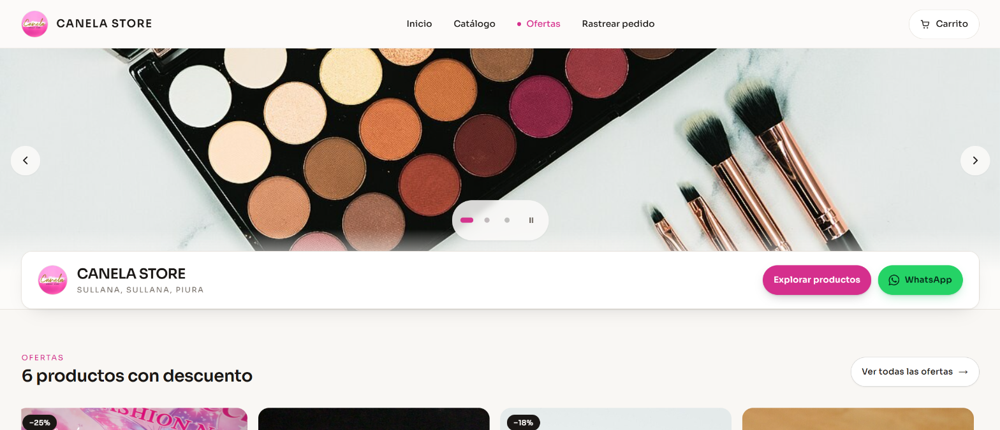
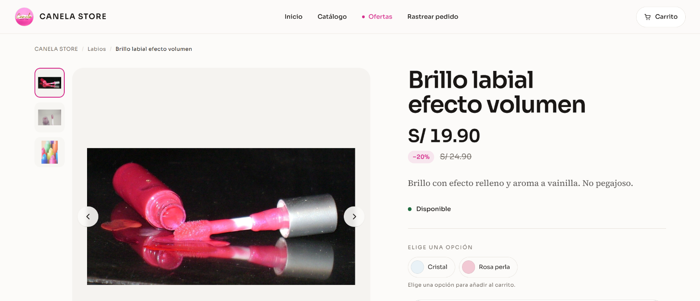
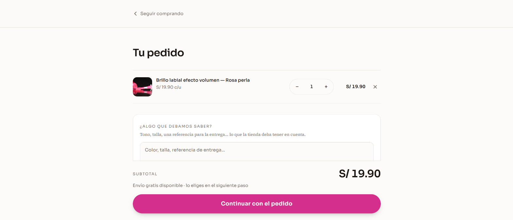
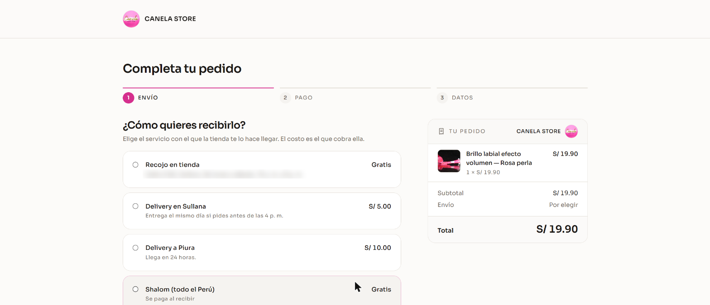
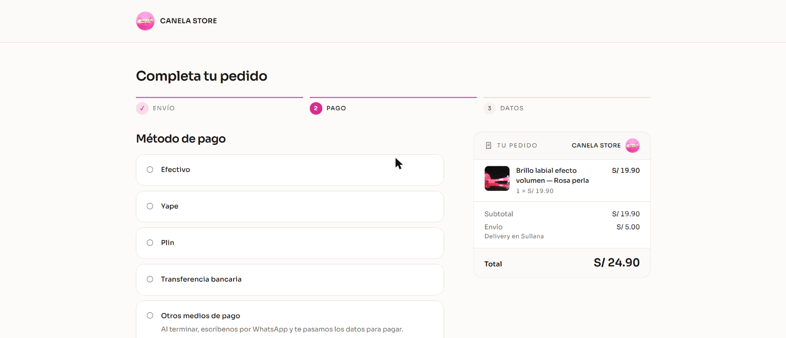
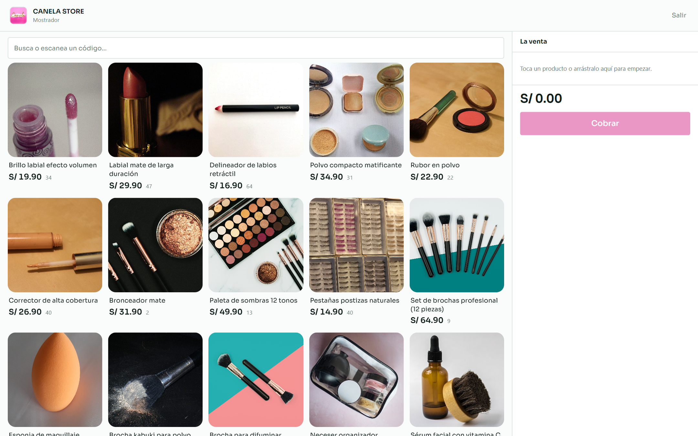
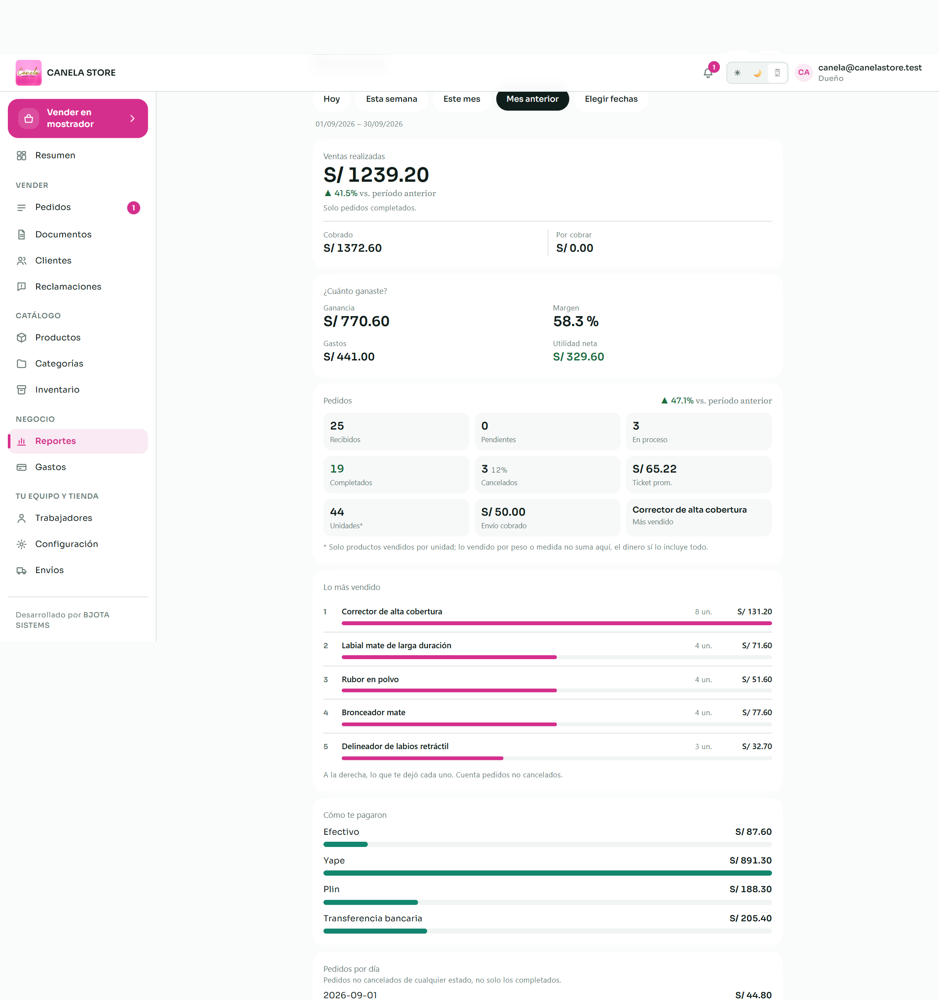
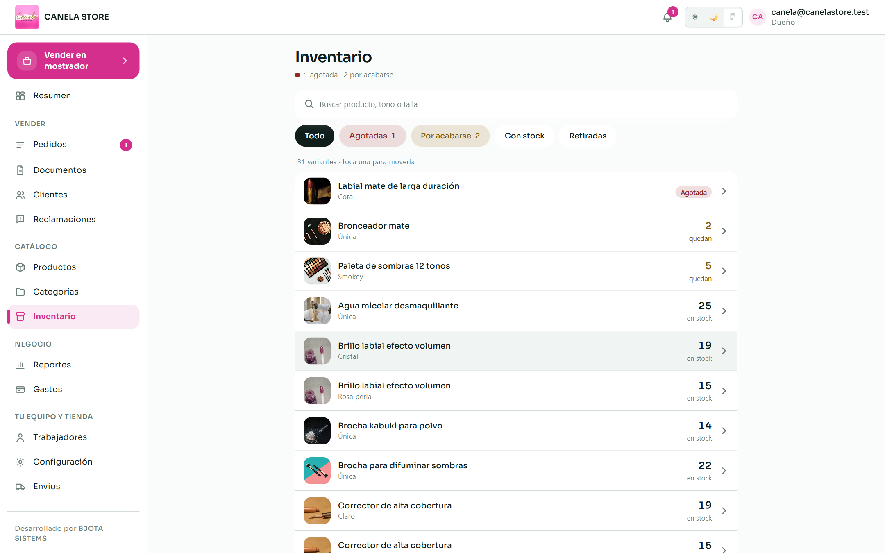
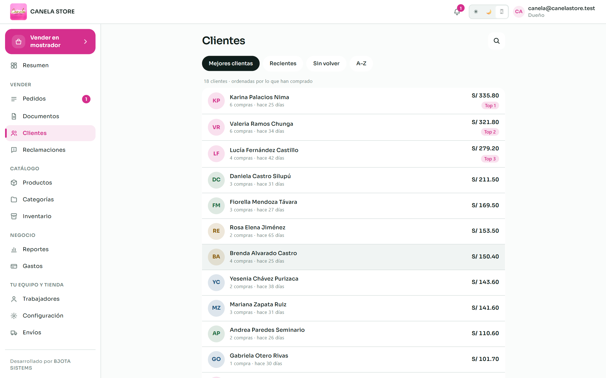
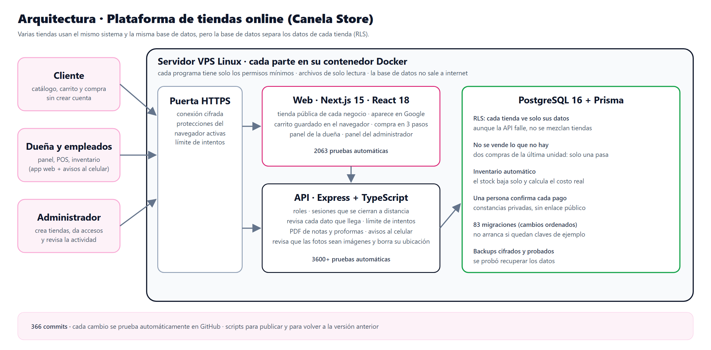

# Canela Store: tienda online y punto de venta sobre una plataforma multi-tienda

**Comercio electrónico para MYPES · En producción en [tiendas.bjota.online](https://tiendas.bjota.online/canela-store) · 2026**

Es una plataforma tipo «Kyte» hecha a medida. Ofrece:
- **Tienda online:** catálogo con variantes, carrito y checkout **sin crear cuenta**.
- **Pagos:** por Yape o Plin, con confirmación de la dueña.
- **Mostrador (POS)** para vender en la tienda física.
- **Inventario** que baja solo con cada venta.
- **Reportes** de utilidad.

La primera clienta es **Canela Store**, una tienda de maquillaje y regalos de Sullana, Piura.

🛍️ **[Ver la tienda en vivo](https://tiendas.bjota.online/canela-store)** · 📄 **[Caso de estudio completo (PDF)](docs/caso-de-estudio.pdf)**

---

## El problema

Canela Store vendía por WhatsApp e Instagram:

- **Cada venta era una conversación:** fotos, precios y datos de envío a mano, y sin catálogo propio.
- **El stock no se actualizaba:** la app que usaba no descontaba el stock al entrar un pedido online.
- **Pagos por Yape difíciles de controlar:** había constancias sueltas en el chat.
- **Sin saber cuánto se ganaba:** no había costo por producto ni gastos registrados.

## La solución

| Módulo | Qué hace |
|---|---|
| **Tienda online** | Catálogo con variantes de tono, ofertas, buscador, carrito y checkout en 3 pasos (envío, pago y datos); seguimiento del pedido sin cuenta; SEO y sitemap |
| **Pagos** | Efectivo, Yape, Plin, transferencia u "otros". El cliente adjunta su constancia y la dueña la confirma |
| **Pedidos** | Por checkout, venta manual o proforma; máquina de estados; edición; cancelación que repone el stock |
| **Mostrador (POS)** | Venta en la tienda física con pago dividido y vuelto |
| **Inventario** | Kardex con costo promedio ponderado y alertas de agotado y "por acabarse" |
| **Reportes** | Ventas, ganancia, margen, utilidad neta tras gastos, más vendidos y cobros por método; exportación a CSV |
| **Documentos** | Notas de venta y proformas en PDF |
| **Plataforma** | Multi-tienda con panel master, roles, enlaces de acceso de un solo uso, avisos push y libro de reclamaciones |

## La tienda (en producción)

| Ficha con variantes | Carrito |
|---|---|
|  |  |
| **Checkout: envío** | **Checkout: pago** |
|  |  |

## El panel de la dueña

| Reportes de utilidad | Inventario | Clientes |
|---|---|---|
|  |  |  |

## Arquitectura

**Decisiones clave:**
- **RLS forzado y un usuario sin privilegios:** cada fila lleva `storeId`, y PostgreSQL filtra con `FORCE ROW LEVEL SECURITY`. La app entra como `app_user` sin `BYPASSRLS`.
- **Pedidos transaccionales** con `SELECT … FOR UPDATE`: dos clientes no pueden comprar la última unidad a la vez.
- **Confirmación humana del pago:** las constancias quedan en almacenamiento privado, sin URL pública.
- **Sesiones revocables:** JWT con `tokenVersion` y enlaces de acceso de un solo uso.
- **Secretos:** el servidor no arranca si detecta secretos de plantilla sin cambiar.
- **Contenedores endurecidos:** `cap_drop: ALL`, `no-new-privileges`, solo lectura y la base de datos en una red interna.

## Seguridad probada

- Auditoría de la Fase 1 sin hallazgos críticos ni altos.
- Ataques de prueba en un entorno réplica:
  - XSS con nombres de tienda ``;
  - `X-Forwarded-For` falsificado contra el rate limiting;
  - verificación de HTTPS, HSTS y CSP.
- Rate limiting en el login y en los pedidos públicos; imágenes validadas por su tipo real y sin metadatos EXIF.
- Backups cifrados con restic, con un ensayo de restauración.
- CI en GitHub Actions: pruebas, tipos y build.

## Lo que pidió la clienta

Tras ver la demo, la dueña pidió **6 mejoras** y **todas se implementaron**:
- modo mostrador (POS);
- checkout según el tipo de envío;
- pago "a coordinar";
- edición de pedidos;
- nota de venta en PDF;
- precio por mayor.

## Calidad

- **2063 pruebas de la web** (Vitest), todas pasan; las verifiqué el 17/10/2026.
- **3622 pruebas de la API** (Vitest + Supertest) en la última corrida completa registrada, más 7 omitidas.
- **83 migraciones** de Prisma y **366 commits**.

## Mi rol

Proyecto propio de principio a fin:
- levanté los requisitos con la dueña de Canela;
- diseñé la base de datos y la arquitectura;
- desarrollé la API y la web con apoyo de asistentes de IA, y escribí las pruebas;
- endurecí y desplegué la infraestructura;
- implementé los cambios que pidió la clienta.

---

> 🔒 **Repositorio vitrina:** no se publican el código fuente, los datos de clientes reales ni los detalles internos del servidor.
>
> Sobre las capturas:
> - La tienda pública se capturó en producción, sin enviar pedidos.
> - El panel viene de la base de desarrollo local, con datos de demostración.
> - Las fotos de productos son de Wikimedia Commons, con licencia libre.

**Bryan Jeremy Espinoza Herrera** · BJOTA Systems · Perú
